# DataWitness Africa — Document technique

> Rendre les chiffres publics **vérifiables, comparables et explicables**.
> Hackathon *L'Aube de l'Intelligence Artificielle — Édition 2* · 14 novembre 2026 · HESTIM, Casablanca

| | |
|---|---|
| **Version** | 0.1 — 13 octobre 2026 |
| **Équipe** | DJERADE GOLBE Parfait (Data & Qualité) · KOMOSSI Sosso (IA & Analyse) · YENDONGOU Damtoti (Technique & Chef de projet) |
| **Établissement** | UCAO-UUT — Togo · COTIA |
| **Documents sources** | [`sources/DataWitness_AubeIA2026.pdf`](sources/DataWitness_AubeIA2026.pdf) · [`sources/Proposition_1_DataWitness_Africa_Dossier.docx`](sources/Proposition_1_DataWitness_Africa_Dossier.docx) |

Les diagrammes sont en **Mermaid** (rendus nativement par GitHub, GitLab, VS Code).

---

## Sommaire

1. [Synthèse des documents](#1-synthèse-des-documents)
2. [Exigences](#2-exigences)
3. [Contexte et acteurs](#3-contexte-et-acteurs)
4. [Architecture](#4-architecture)
5. [Pipeline de traitement](#5-pipeline-de-traitement)
6. [Modèle de données](#6-modèle-de-données)
7. [Logique de vérification](#7-logique-de-vérification)
8. [Diagrammes de séquence](#8-diagrammes-de-séquence)
9. [Cycles de vie (états)](#9-cycles-de-vie-états)
10. [API REST](#10-api-rest)
11. [Interface web](#11-interface-web)
12. [Déploiement](#12-déploiement)
13. [Choix technologiques](#13-choix-technologiques)
14. [Qualité, tests et garde-fous](#14-qualité-tests-et-garde-fous)
15. [Limites et risques](#15-limites-et-risques)

---

## 1. Synthèse des documents

**Problème.** Les décisions publiques s'appuient sur des rapports, annuaires, PDF, Excel et bases de données hétérogènes. Le problème n'est pas l'absence de données, mais la difficulté à savoir rapidement si plusieurs chiffres **désignent la même chose**, s'ils sont **à jour**, **comment ils ont été calculés** et **pourquoi ils diffèrent**. Les IA génératives aggravent le risque : elles produisent une réponse fluide à partir de sources incompatibles sans signaler la contradiction.

**Proposition.** Un assistant de vérification qui, à partir de plusieurs documents :

1. extrait les **affirmations quantitatives** et leurs métadonnées ;
2. **rapproche** les indicateurs susceptibles de désigner la même réalité ;
3. **détecte** les écarts significatifs ;
4. **distingue** contradiction réelle / différence de périmètre ou de méthode / comparaison invalide ;
5. attribue un **niveau de confiance expliqué** ;
6. permet de **remonter à la source** (document, page, tableau, passage).

**Principe directeur : la « preuve active ».** L'IA sert à l'extraction, au rapprochement sémantique et à l'explication ; les **règles déterministes** et la **traçabilité** empêchent qu'une réponse générée soit prise pour une preuve.

**Périmètre du prototype.** Un domaine (éducation au Togo), un corpus restreint (annuaires INSEED, publications ministérielles, open data) et **trois cas de démonstration** :

| Cas | Situation | Verdict attendu |
|---|---|---|
| 1 | Deux valeurs concordantes | `concordant` |
| 2 | Deux valeurs différentes expliquées par période / périmètre / méthode | `explained_difference` |
| 3 | Écart inexpliqué à soumettre à un humain | `unexplained_contradiction` |

> Les valeurs 18,2 % / 23,7 % du dossier sont **illustratives** : chaque valeur affichée par le prototype devra provenir d'une source réelle vérifiable.

---

## 2. Exigences

### 2.1 Fonctionnelles

| ID | Exigence | Priorité |
|---|---|---|
| F1 | Déposer / sélectionner des sources PDF, XLSX, CSV | Must |
| F2 | Extraire texte, tableaux, valeurs, unités, dates (+ OCR des pages scannées) | Must |
| F3 | Conserver pour chaque valeur : source, date, page/emplacement, indicateur, période, unité, zone, population, contexte | Must |
| F4 | Normaliser indicateurs, périodes, zones, unités via des référentiels | Must |
| F5 | Rapprocher sémantiquement les indicateurs (formulations différentes) | Must |
| F6 | Contrôler la comparabilité (période, unité, zone, population, définition, méthode) | Must |
| F7 | Détecter les écarts et produire un verdict parmi 4 | Must |
| F8 | Calculer un niveau de confiance **accompagné de raisons** | Must |
| F9 | Générer une explication textuelle **ancrée uniquement dans les extraits** | Should |
| F10 | Fiche de preuve : valeurs côte à côte, passages, lien vers la page source | Must |
| F11 | Tableau des divergences filtrable | Must |
| F12 | Graphe des relations indicateur–valeur–source–période–territoire | Should |
| F13 | Validation/correction humaine d'une valeur, tracée dans le journal | Should |
| F14 | Export de la fiche de preuve (JSON / PDF) | Could |

### 2.2 Non fonctionnelles

| ID | Exigence |
|---|---|
| NF1 | **Traçabilité totale** : toute valeur affichée est reliée à un fragment source ; aucune valeur sans preuve |
| NF2 | **Non-hallucination** : le LLM ne reçoit et ne cite que les extraits ; une preuve absente est signalée comme telle |
| NF3 | **Explicabilité** : le verdict est issu de règles lisibles, pas du LLM |
| NF4 | **Reproductibilité** : empreinte SHA-256 des fichiers, journal d'audit horodaté |
| NF5 | **Respect des licences** des documents publics |
| NF6 | Démarrage complet en une commande (`make up`) ; démo hors-ligne possible (sauf explication LLM) |
| NF7 | Interface en français, temps de réponse < 2 s sur les vues de consultation |

---

## 3. Contexte et acteurs

### 3.1 Diagramme de contexte (C4 — niveau 1)

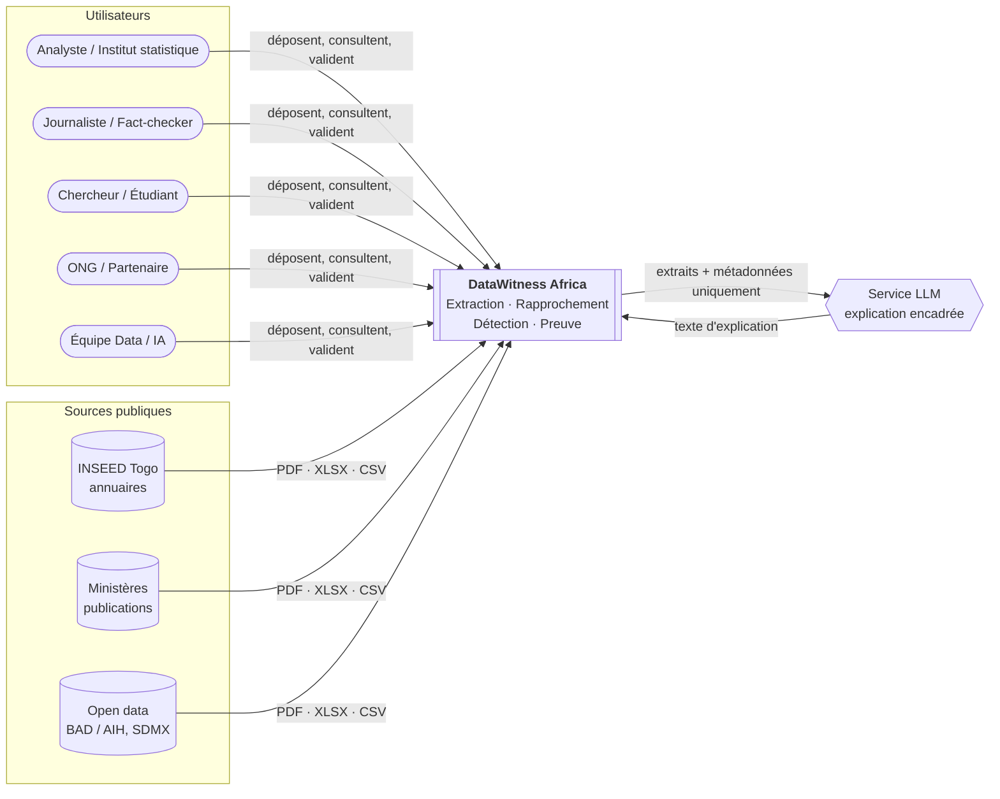

### 3.2 Cas d'utilisation

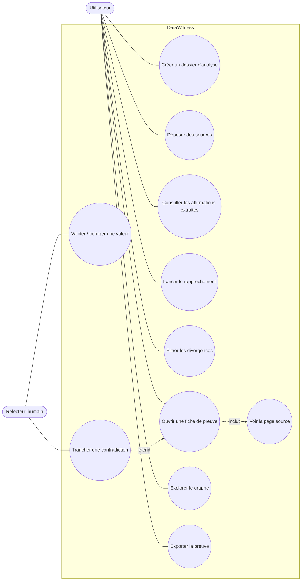

---

## 4. Architecture

### 4.1 Architecture en couches

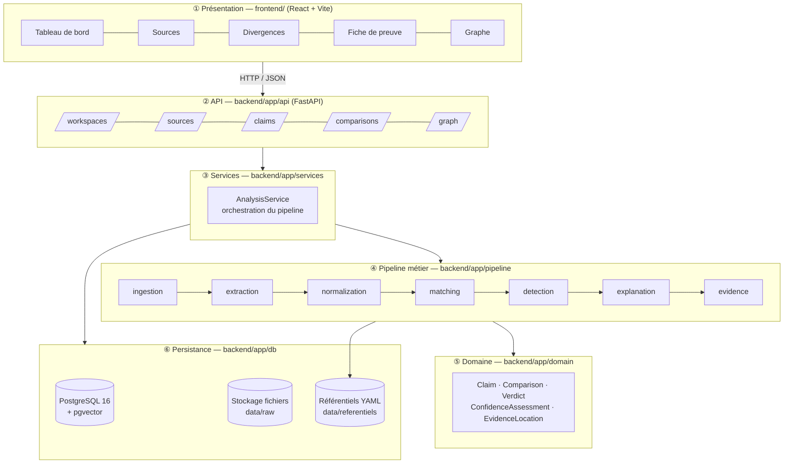

**Règle de dépendance** : chaque couche ne dépend que des couches inférieures. Le **domaine** est pur (dataclasses, aucune dépendance à FastAPI ou SQLAlchemy) → les règles de comparabilité et de verdict sont testables unitairement.

### 4.2 Diagramme de conteneurs (C4 — niveau 2)

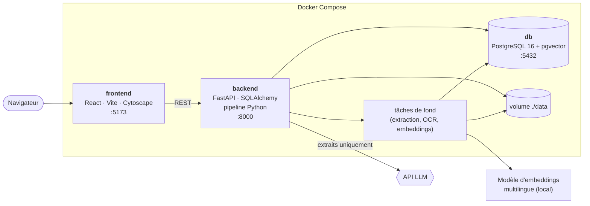

### 4.3 Arborescence du dépôt

```
datawiteness/
├── backend/
│   ├── app/
│   │   ├── api/v1/routes/      # ② endpoints REST
│   │   ├── services/           # ③ orchestration
│   │   ├── pipeline/           # ④ les 7 étapes de traitement
│   │   │   ├── ingestion/  extraction/  normalization/  matching/
│   │   │   └── detection/  explanation/  evidence/
│   │   ├── domain/             # ⑤ objets métier purs + enums
│   │   ├── db/                 # ⑥ ORM, session, repositories
│   │   ├── schemas/            # DTO Pydantic
│   │   ├── core/               # config, logs
│   │   └── workers/            # tâches longues
│   ├── migrations/             # Alembic
│   ├── tests/{unit,integration}
│   └── scripts/                # seed des référentiels…
├── frontend/src/{pages,components,api,hooks,types}
├── data/{raw,interim,processed,corpus,referentiels}
├── notebooks/                  # exploration corpus, évaluation
├── infra/postgres/init.sql
├── docs/
└── docker-compose.yml · Makefile · .env.example
```

---

## 5. Pipeline de traitement

Le dossier décrit 8 étapes ; l'étape 8 (Interface) est portée par la couche présentation.

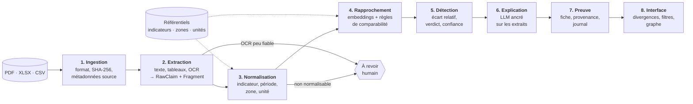

| Étape | Module | Entrée → Sortie | Techniques | Responsable |
|---|---|---|---|---|
| 1 Ingestion | `pipeline/ingestion` | fichier → `Source` | détection de format, SHA-256 (dédoublonnage) | Damtoti |
| 2 Extraction | `pipeline/extraction` | `Source` → `Fragment` + `RawClaim` | PyMuPDF (texte + bbox), pdfplumber (tableaux), Tesseract (OCR fra), pandas/openpyxl, regex des nombres FR | Parfait |
| 3 Normalisation | `pipeline/normalization` | `RawClaim` → `Claim` | référentiels YAML, parsing de périodes (« 2019-2020 », « année scolaire »), conversions d'unités, hiérarchie géographique | Parfait |
| 4 Rapprochement | `pipeline/matching` | `Claim` × pool → paires candidates + contrôles | embeddings multilingues (pgvector, cosinus), RapidFuzz sur libellés, règles de comparabilité | Sosso |
| 5 Détection | `pipeline/detection` | paire → `ComparisonResult` + `ConfidenceAssessment` | écart relatif, arbre de décision, score de confiance pondéré | Sosso |
| 6 Explication | `pipeline/explanation` | résultat → texte | LLM avec prompt contraint, citations [A]/[B], température 0 | Sosso |
| 7 Preuve | `pipeline/evidence` | résultat → fiche | assemblage provenance, `AuditEvent` | Damtoti |
| 8 Interface | `frontend/` | API → vues | React, React Query, Cytoscape | Damtoti |

### 5.1 Détail de l'extraction

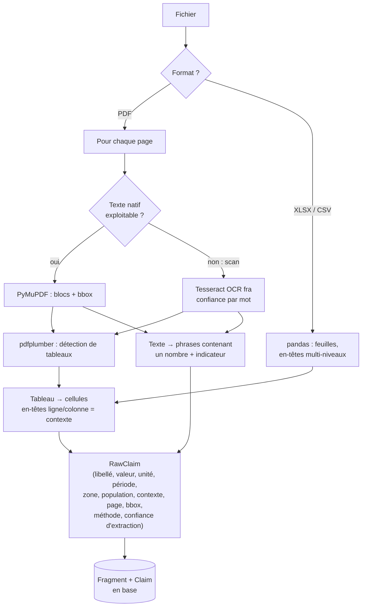

---

## 6. Modèle de données

### 6.1 Diagramme entité-association

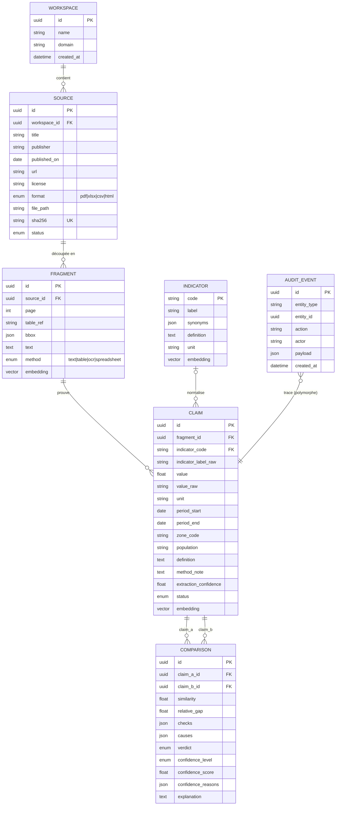

Implémentation : [`backend/app/db/models.py`](../backend/app/db/models.py).

### 6.2 Diagramme de classes du domaine

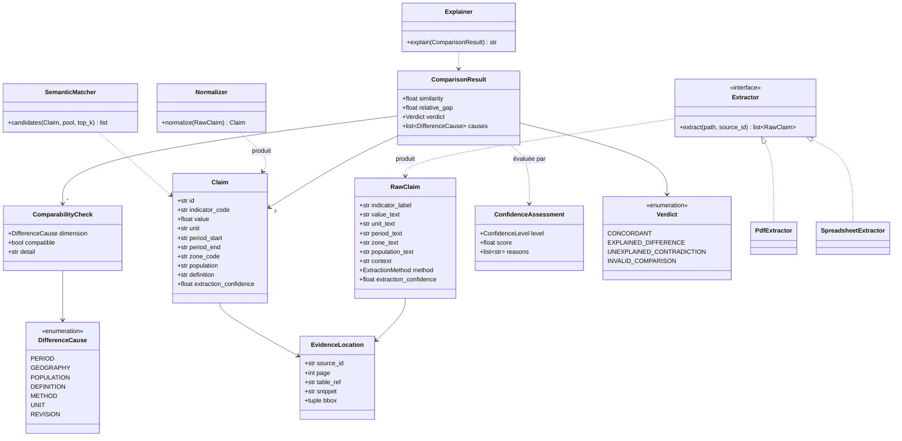

Implémentation : [`backend/app/domain/`](../backend/app/domain/).

---

## 7. Logique de vérification

### 7.1 Contrôles de comparabilité

Avant toute comparaison de valeurs, six dimensions sont contrôlées (règles déterministes, `pipeline/matching/comparability.py`) :

| Dimension | Compatible si… | Exemple d'incompatibilité |
|---|---|---|
| Période | intervalles identiques (ou chevauchement total) | 2019-2020 vs 2021-2022 |
| Territoire | même code zone | National vs Région Savanes |
| Population | même population cible | Filles vs Ensemble |
| Unité | même unité après conversion | % vs effectif |
| Définition | même code indicateur et définition non contradictoire | Abandon *intra-annuel* vs *cumulé* |
| Méthode | même méthode ou méthode inconnue (→ baisse de confiance) | Enquête ménages vs données administratives |

### 7.2 Arbre de décision du verdict

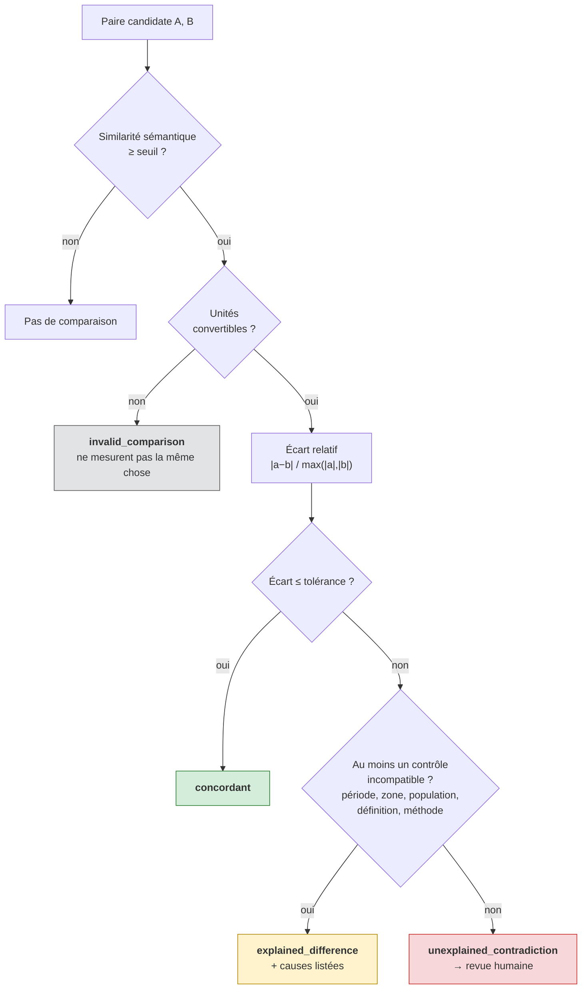

Implémentation de référence : `decide_verdict()` dans [`backend/app/pipeline/detection/detector.py`](../backend/app/pipeline/detection/detector.py) (testé dans `tests/unit/test_detection.py`).

### 7.3 Niveau de confiance expliqué

Le score n'est **jamais présenté seul** : il est toujours accompagné de ses raisons.

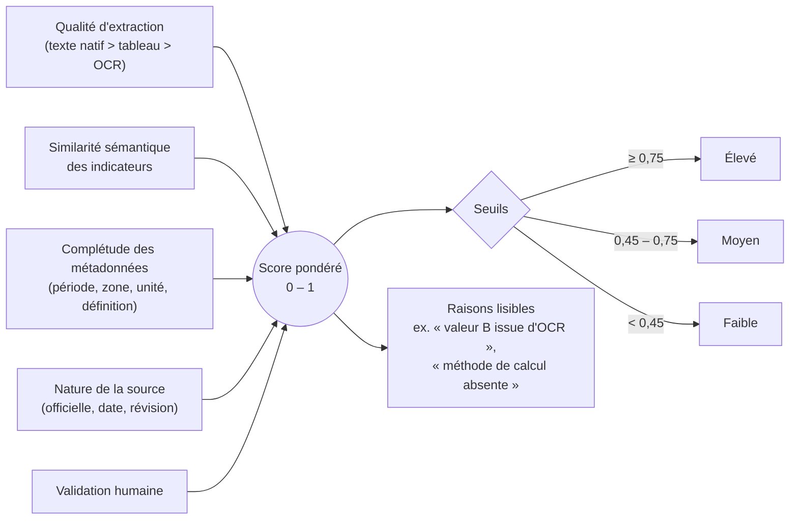

Pondérations initiales (à calibrer sur le jeu de démo) : extraction 0,30 · similarité 0,20 · complétude 0,25 · source 0,15 · validation humaine 0,10.

### 7.4 Explication encadrée (anti-hallucination)

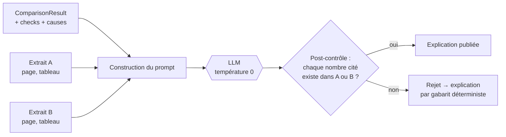

Le verdict est **calculé avant** l'appel au LLM ; celui-ci ne fait que le formuler. Si le LLM est indisponible, un gabarit textuel construit à partir des `checks` est utilisé.

### 7.5 Graphe de provenance (exemple)

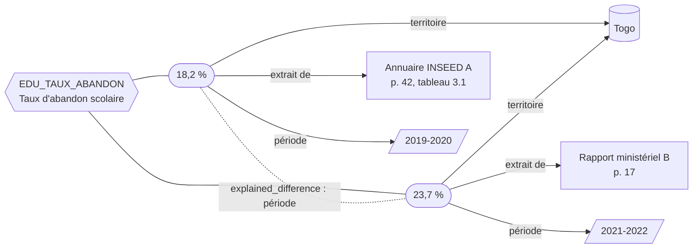

*(valeurs illustratives)*

---

## 8. Diagrammes de séquence

### 8.1 Dépôt et extraction d'une source

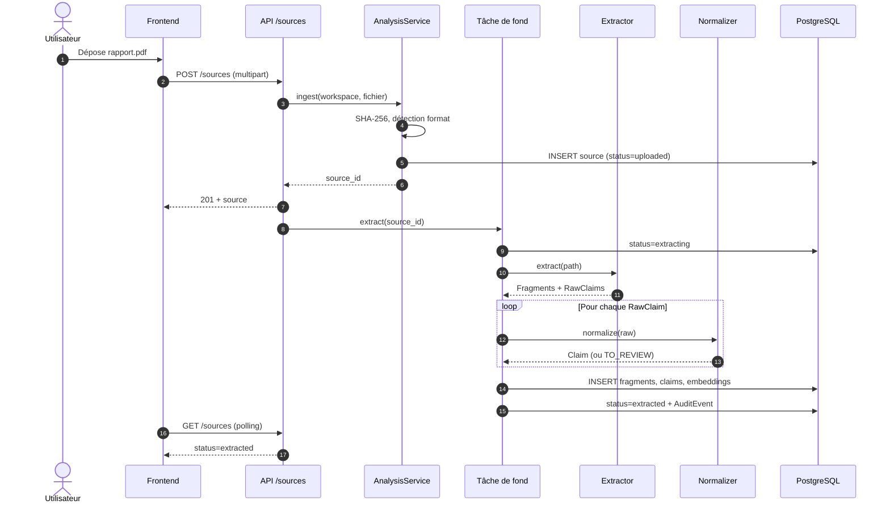

### 8.2 Rapprochement, détection et fiche de preuve

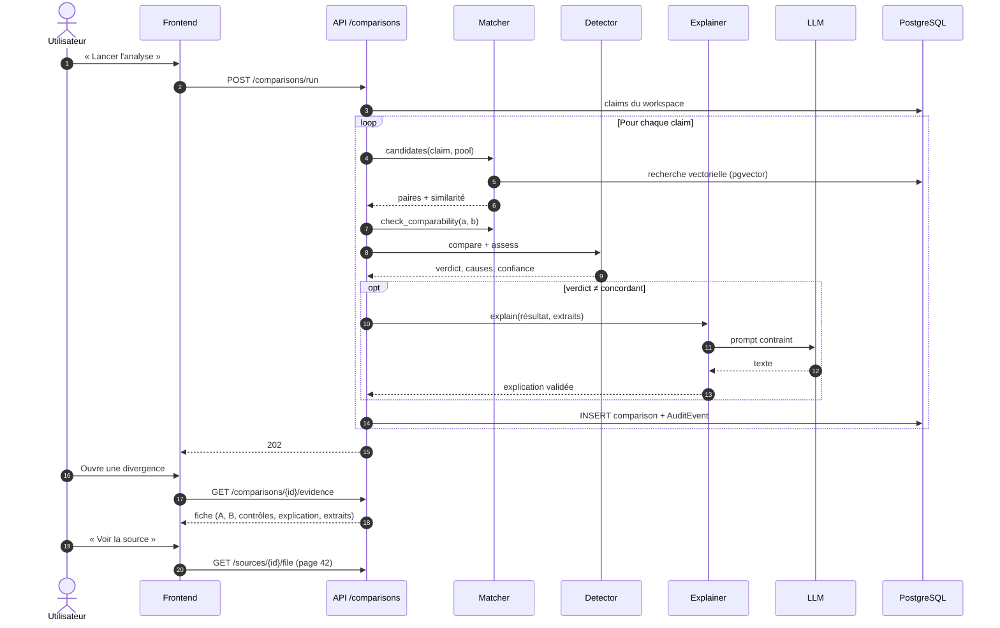

### 8.3 Validation humaine

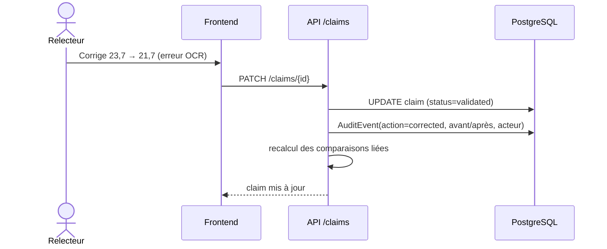

---

## 9. Cycles de vie (états)

### 9.1 Source

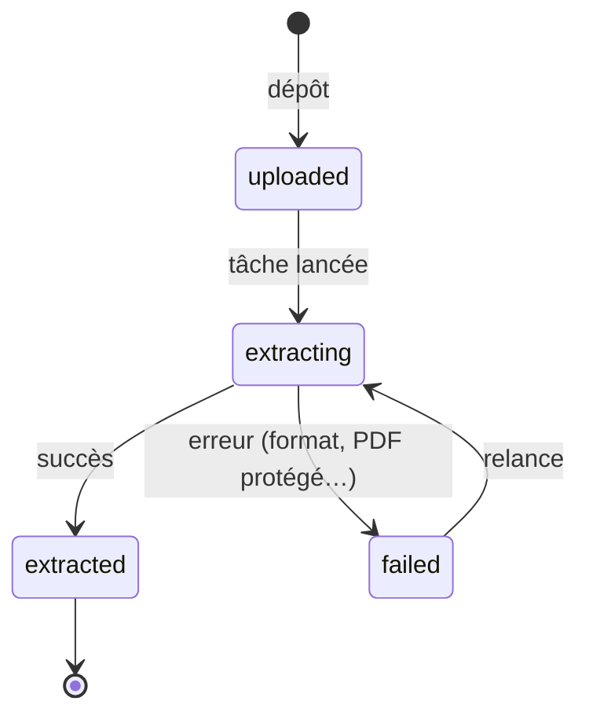

### 9.2 Affirmation (Claim)

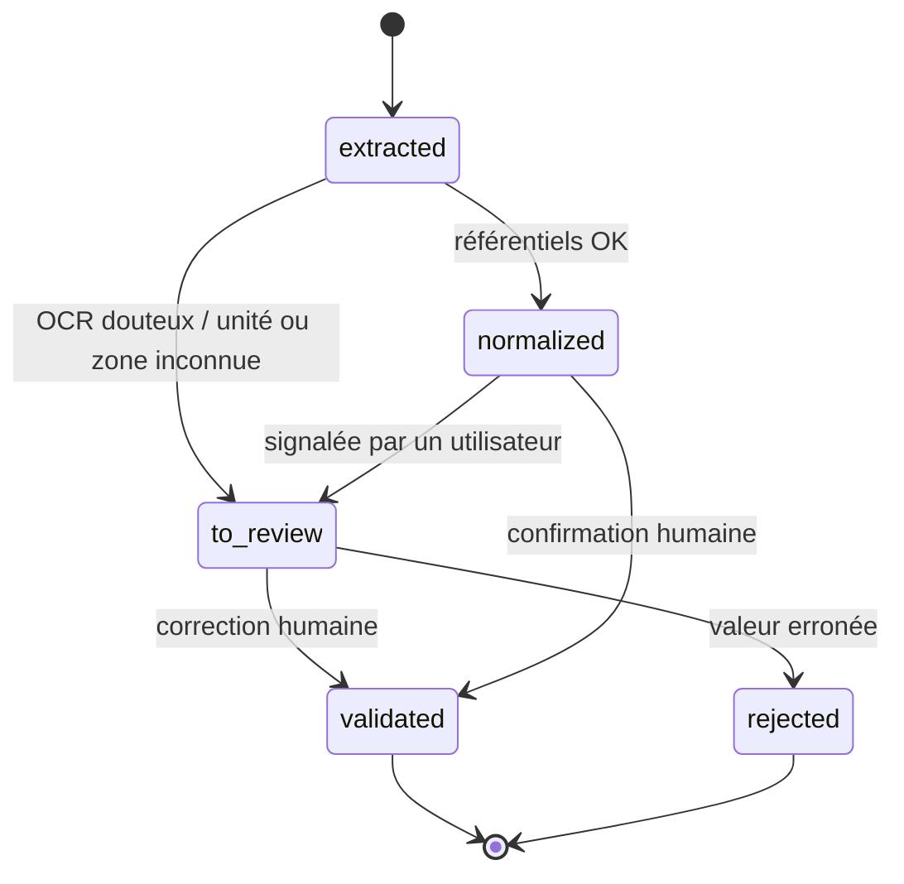

### 9.3 Comparaison

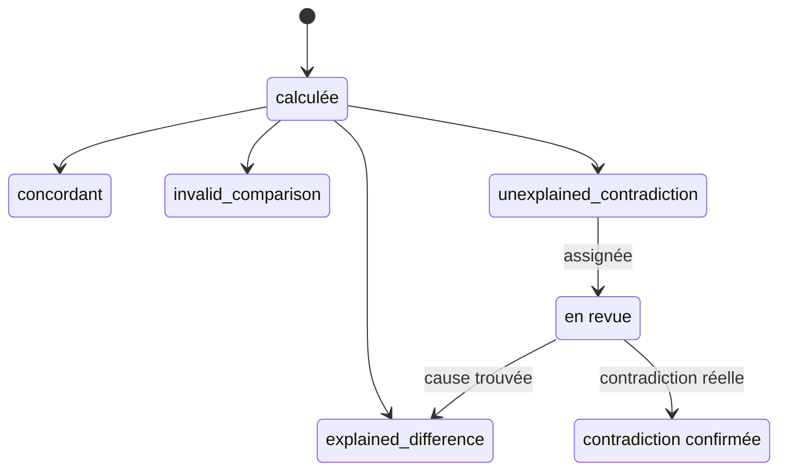

---

## 10. API REST

Base : `/api/v1` — documentation interactive : `http://localhost:8000/docs`.

| Méthode | Route | Rôle |
|---|---|---|
| GET | `/health` | État de l'API |
| POST / GET | `/workspaces` | Créer / lister les dossiers d'analyse |
| POST | `/sources?workspace_id=` | Déposer un fichier (multipart) |
| GET | `/sources?workspace_id=` | Lister les sources et leur statut |
| GET | `/sources/{id}/file` | Fichier original (affichage de la page de preuve) |
| GET | `/claims?workspace_id=&indicator_code=` | Affirmations extraites |
| PATCH | `/claims/{id}` | Validation / correction humaine |
| POST | `/comparisons/run?workspace_id=` | Lancer rapprochement + détection |
| GET | `/comparisons?workspace_id=&verdict=` | Tableau des divergences |
| GET | `/comparisons/{id}/evidence` | Fiche de preuve complète |
| GET | `/graph?workspace_id=&indicator_code=` | Graphe de provenance (format Cytoscape) |

Exemple de fiche de preuve (`GET /comparisons/{id}/evidence`) :

```json
{
  "comparison": {
    "verdict": "explained_difference",
    "causes": ["period"],
    "relative_gap": 0.232,
    "confidence_level": "medium",
    "confidence_reasons": ["valeur B issue d'un tableau", "méthode de calcul absente dans A"],
    "explanation": "Les deux valeurs portent sur des années scolaires différentes [A] 2019-2020, [B] 2021-2022…",
    "claim_a": { "value": 18.2, "unit": "PCT", "period_start": "2019-09-01", "zone_code": "TG" },
    "claim_b": { "value": 23.7, "unit": "PCT", "period_start": "2021-09-01", "zone_code": "TG" }
  },
  "evidence_a": { "source_title": "Annuaire A", "page": 42, "table_ref": "T3.1", "snippet": "…" },
  "evidence_b": { "source_title": "Rapport B", "page": 17, "table_ref": null, "snippet": "…" }
}
```

---

## 11. Interface web

### 11.1 Navigation

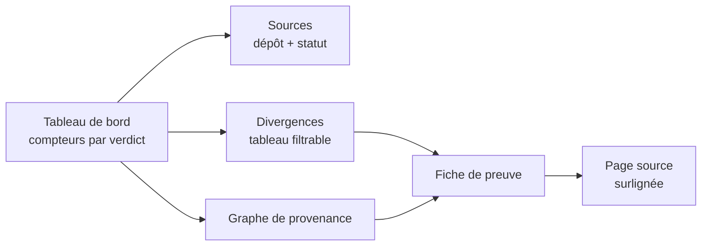

### 11.2 Maquette de la fiche de preuve

```
┌───────────────────────────────────────────────────────────────────────┐
│  Taux d'abandon scolaire — Togo          ⚠ DIFFÉRENCE EXPLIQUÉE      │
│  Confiance : MOYENNE  (valeur B issue d'un tableau ; méthode A absente)│
├──────────────────────────────────┬────────────────────────────────────┤
│  SOURCE A                        │  SOURCE B                          │
│  18,2 %                          │  23,7 %                            │
│  Période  2019-2020        ✗     │  Période  2021-2022                │
│  Zone     Togo             ✓     │  Zone     Togo                     │
│  Unité    %                ✓     │  Unité    %                        │
│  Annuaire A · p.42 · T3.1 [voir] │  Rapport B · p.17        [voir]    │
│  « …extrait… »                   │  « …extrait… »                     │
├──────────────────────────────────┴────────────────────────────────────┤
│  Explication : les deux valeurs portent sur des années scolaires      │
│  différentes [A][B] ; la comparaison directe n'est pas valide.        │
│                              [Valider]  [Signaler]  [Exporter]        │
└───────────────────────────────────────────────────────────────────────┘
```

Code de couleur des verdicts : vert = concordant · orange = différence expliquée · rouge = contradiction inexpliquée · gris = comparaison invalide.

---

## 12. Déploiement

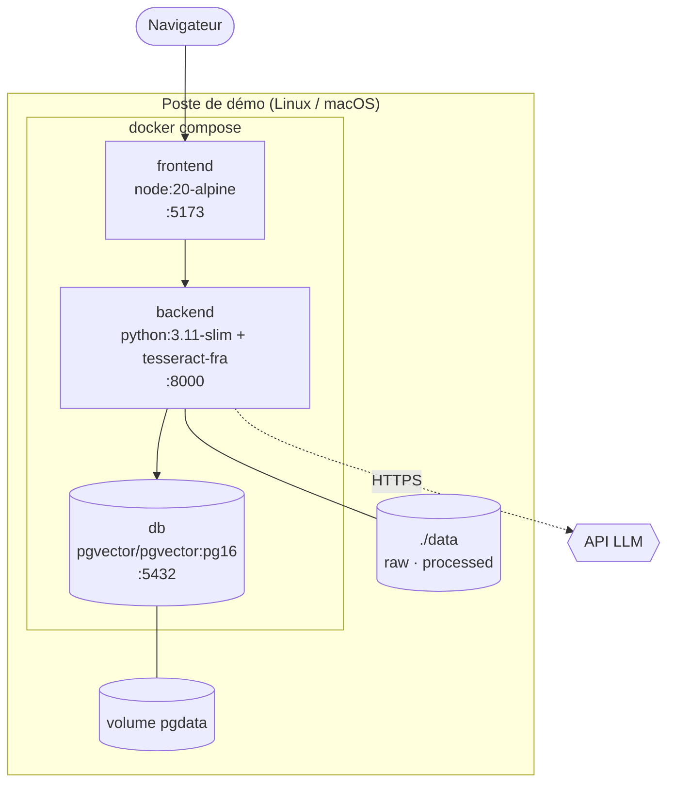

```bash
cp .env.example .env      # renseigner ANTHROPIC_API_KEY (optionnel)
make up                   # db + backend + frontend
# ou en développement :
make db && make install-back && make migrate && make back
make install-front && make front
```

**Plan B démo** : base pré-remplie (dump SQL du corpus de démonstration) + explications pré-calculées, pour une démonstration sans réseau.

---

## 13. Choix technologiques

| Besoin | Choix | Justification | Alternative |
|---|---|---|---|
| Langage pipeline | Python 3.10+ | écosystème data/IA, compétences de l'équipe | — |
| API | FastAPI | typage Pydantic, OpenAPI auto, async | Flask |
| Base de données | PostgreSQL 16 + pgvector | relationnel + vectoriel dans un seul moteur | SQLite + FAISS |
| Texte PDF | PyMuPDF | rapide, coordonnées (bbox) pour surligner la preuve | pdfminer |
| Tableaux PDF | pdfplumber | tableaux à bordures fréquents dans les annuaires | Camelot |
| OCR | Tesseract (fra) | libre, local | docTR, EasyOCR |
| Excel / CSV | pandas + openpyxl | standard | — |
| Embeddings | `paraphrase-multilingual-MiniLM-L12-v2` (384 d) | multilingue FR, léger, CPU | bge-m3 |
| Similarité de libellés | RapidFuzz | robuste aux variantes orthographiques | — |
| Explication | LLM via API (Claude), température 0 | qualité en français, suivi des consignes | LLM local (Ollama) |
| Frontend | React 18 + Vite + TypeScript | interface riche (fiche, graphe) | Streamlit (plan B rapide) |
| Graphe | Cytoscape.js | graphe interactif de provenance | vis-network |
| Migrations | Alembic | versionnement du schéma | — |
| Packaging | uv · npm · Docker Compose | installation reproductible | — |

---

## 14. Qualité, tests et garde-fous

| Niveau | Contenu | Outil |
|---|---|---|
| Unitaires | parsing des nombres FR, périodes, unités, règles de comparabilité, verdict, score de confiance | pytest |
| Intégration | endpoints API, pipeline complet sur 2-3 fichiers d'exemple | pytest + TestClient |
| Évaluation extraction | précision / rappel sur un échantillon annoté manuellement (≥ 50 valeurs) | notebook |
| Évaluation rapprochement | précision des paires sur les indicateurs du référentiel | notebook |
| Démo | les 3 cas (concordant, expliqué, inexpliqué) reproduits de bout en bout | script de démo |
| Lint | style et imports | ruff, tsc |

**Garde-fous éthiques et techniques**

- Aucune valeur sans `fragment_id` → contrainte en base (FK non nulle).
- Le LLM ne produit **jamais** de verdict ni de chiffre ; post-contrôle des nombres cités.
- Toute correction humaine est journalisée (avant / après / acteur).
- Licence et URL de chaque source conservées et affichées.

---

## 15. Limites et risques

| Risque | Impact | Mitigation |
|---|---|---|
| OCR erroné sur tableaux scannés | valeurs fausses | confiance d'extraction, statut `to_review`, validation humaine des valeurs critiques |
| Une divergence n'est pas une erreur | faux positifs | contrôles de comparabilité **avant** verdict ; vocabulaire prudent (« possible ») |
| Documents eux-mêmes erronés ou révisés | confusion | cause `REVISION`, date de publication affichée |
| Peu d'indicateurs communs entre sources | démo pauvre | sélection volontaire du corpus dès la phase 1 |
| LLM indisponible le jour J | pas d'explication | gabarit déterministe + explications pré-calculées |
| Temps limité (≈ 1 mois) | périmètre non tenu | MVP strict = 3 cas sur 1 domaine ; Streamlit en plan B UI |
| Droits de réutilisation | juridique | vérifier les licences INSEED / ministères à l'ingestion |

---

*Planification détaillée : voir [`PLANIFICATION.md`](PLANIFICATION.md).*
