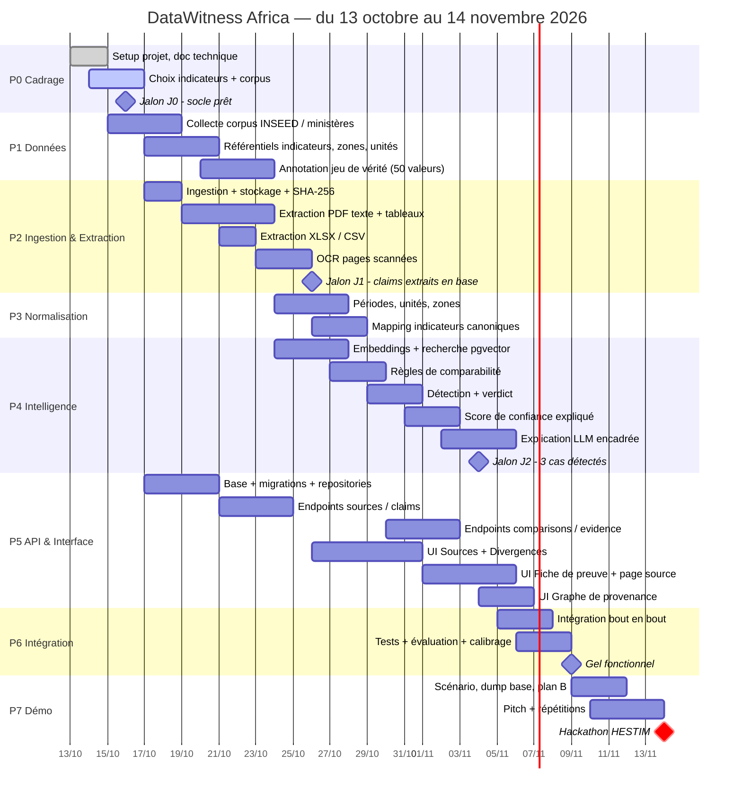
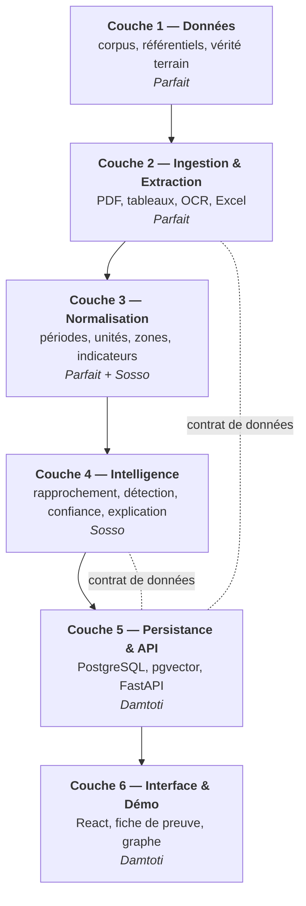
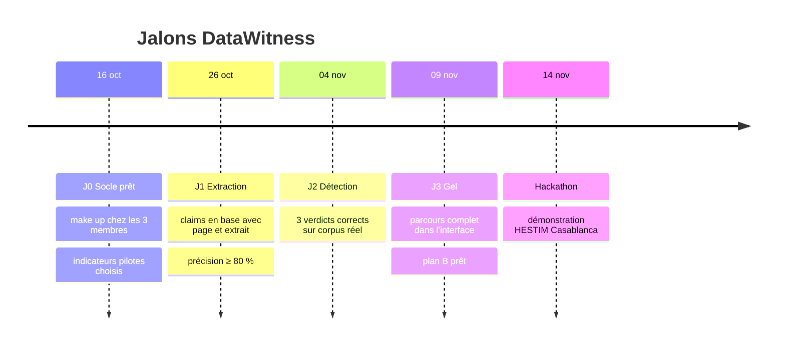

# DataWitness Africa — Planification

**Période** : 13 octobre → 14 novembre 2026 (≈ 4,5 semaines) · **Échéance** : démonstration au hackathon, HESTIM Casablanca, **14/11/2026**.

| Rôle | Membre | Couches principales |
|---|---|---|
| **Data & Qualité** | DJERADE GOLBE Parfait | Corpus · Référentiels · Ingestion · Extraction · Normalisation |
| **IA & Analyse** | KOMOSSI Sosso | Rapprochement · Détection · Confiance · Explication |
| **Technique & Chef de projet** | YENDONGOU Damtoti | Architecture · Base · API · Interface · Intégration · Démo |

---

## 1. Vue d'ensemble

---

## 2. Organisation par couches

Le projet est découpé en **6 couches** qui avancent en parallèle, synchronisées par 4 jalons.

**Contrat d'interface entre membres** : les dataclasses de [`backend/app/domain/claim.py`](../backend/app/domain/claim.py) (`RawClaim`, `Claim`, `ComparisonResult`, `ConfidenceAssessment`) et les schémas Pydantic de [`backend/app/schemas/`](../backend/app/schemas/). Les modifier = prévenir l'équipe.

---

## 3. Détail des phases

### P0 — Cadrage et socle · 13 → 16 oct.

| Tâche | Resp. | Livrable | Statut |
|---|---|---|---|
| Lecture des dossiers, synthèse | Tous | `DOCUMENT_TECHNIQUE.md` §1 | ✅ |
| Architecture, diagrammes | Damtoti | `DOCUMENT_TECHNIQUE.md` | ✅ |
| Squelette backend / frontend / docker | Damtoti | dépôt actuel | ✅ |
| Choisir 3 à 5 indicateurs éducation présents dans ≥ 2 sources | Parfait + Sosso | liste validée | ☐ |
| Clé API LLM, accès machines, dépôt GitHub partagé | Damtoti | `.env` | ☐ |

**J0 (16/10)** : `make up` fonctionne chez les 3 membres ; indicateurs pilotes choisis.

### P1 — Couche Données · 15 → 23 oct. · *Parfait*

| Tâche | Livrable | Critère de fin |
|---|---|---|
| Télécharger annuaires INSEED + rapports ministériels éducation | `data/corpus/` + fiche source (URL, date, licence) | ≥ 6 documents, ≥ 2 formats |
| Compléter `indicateurs.yaml` (définitions, synonymes) | référentiel | indicateurs pilotes définis |
| Compléter `zones.yaml`, `unites.yaml` | référentiels | régions + préfectures si utiles |
| Annoter manuellement ≥ 50 valeurs (vérité terrain) | `data/processed/verite_terrain.csv` | colonnes = champs `Claim` + page |
| **Identifier les 3 cas de démo réels** | fiche « cas de démo » | 1 concordant, 1 expliqué, 1 inexpliqué |

### P2 — Ingestion & Extraction · 17 → 26 oct. · *Parfait (Damtoti en appui ingestion)*

| Tâche | Module | Critère de fin |
|---|---|---|
| Upload, SHA-256, dédoublonnage | `pipeline/ingestion` | test unitaire |
| Texte PDF + bbox (PyMuPDF) | `pdf_extractor.py` | fragments en base avec page |
| Tableaux (pdfplumber) avec en-têtes comme contexte | `pdf_extractor.py` | tableaux pilotes extraits |
| XLSX / CSV | `spreadsheet_extractor.py` | 1 fichier pilote extrait |
| OCR fallback | `pdf_extractor.py` | confiance d'extraction renseignée |
| Parser de quantités FR | `quantity_parser.py` | tests (« 18,2 % », « 1 234 ») ✅ |

**J1 (26/10)** : les claims du corpus pilote sont en base, avec page et extrait ; précision ≥ 80 % sur la vérité terrain.

### P3 — Normalisation · 24 → 29 oct. · *Parfait + Sosso*

| Tâche | Critère de fin |
|---|---|
| Périodes (« 2019-2020 », « année scolaire 2019/2020 », « 2021 ») → dates | tests unitaires |
| Unités + conversions (%, ‰, effectifs, FCFA) | tests unitaires |
| Zones (libellés → codes hiérarchiques) | tests unitaires |
| Libellé brut → `indicator_code` (fuzzy + embeddings sur synonymes) | ≥ 85 % de bons mappings sur la vérité terrain |
| Statut `to_review` si non normalisable | visible dans l'API |

### P4 — Intelligence · 24 oct. → 5 nov. · *Sosso*

| Tâche | Module | Critère de fin |
|---|---|---|
| Embeddings claims/indicateurs + index pgvector | `matching/matcher.py` | top-k pertinent sur indicateurs pilotes |
| Règles de comparabilité (6 dimensions) | `matching/comparability.py` | tests par dimension |
| Verdict (arbre de décision) | `detection/detector.py` | tests ✅ + 3 cas de démo corrects |
| Score de confiance + raisons | `detection/confidence.py` | raisons lisibles pour chaque cas |
| Explication LLM + post-contrôle des nombres + gabarit de repli | `explanation/explainer.py` | 0 chiffre inventé sur les cas de démo |
| Calibrage seuils (similarité, tolérance) | notebook | valeurs fixées dans `.env` |

**J2 (04/11)** : `POST /comparisons/run` produit les 3 verdicts attendus sur le corpus réel.

### P5 — Persistance, API, Interface · 17 oct. → 7 nov. · *Damtoti*

| Tâche | Critère de fin |
|---|---|
| Première migration Alembic, seed des référentiels | `make migrate` OK |
| Repositories + endpoints workspaces / sources / claims | testés via `/docs` |
| Endpoints comparisons / evidence / graph | fiche de preuve JSON complète |
| Page Sources (dépôt, statut) | upload → statut `extracted` |
| Page Divergences (tableau + filtres verdict/indicateur) | 3 cas visibles |
| Fiche de preuve + ouverture du PDF à la bonne page | clic → page source |
| Graphe Cytoscape | nœuds indicateur/valeur/source/période/zone |
| Validation humaine (PATCH claim + audit) | correction visible + tracée |

### P6 — Intégration et tests · 5 → 9 nov. · *Tous*

- Parcours complet : dépôt → extraction → analyse → fiche → source.
- Rapport d'évaluation : précision extraction, mapping, verdicts.
- Correction des bugs bloquants uniquement.
- **Gel fonctionnel le 09/11** : plus aucune nouvelle fonctionnalité.

### P7 — Démo et présentation · 9 → 14 nov. · *Damtoti (lead), tous*

- Scénario de 5 min autour des 3 cas réels.
- Dump SQL du corpus de démo + explications pré-calculées (plan B hors-ligne).
- Vidéo de secours de la démo.
- Pitch : problème → démo → « preuve active » → impact → suite.
- 2 répétitions chronométrées minimum.

---

## 4. Jalons

---

## 5. Périmètre MVP (MoSCoW)

| Must (démo impossible sans) | Should | Could | Won't (cette édition) |
|---|---|---|---|
| Ingestion PDF + XLSX | OCR | Export PDF de la fiche | Multi-pays |
| Extraction avec page + extrait | Explication LLM | Import SDMX | Comptes utilisateurs |
| Normalisation période / unité / zone | Graphe de provenance | Recherche plein texte | Crawling automatique |
| Rapprochement + règles de comparabilité | Validation humaine | | Prédiction / recommandation |
| 4 verdicts + confiance expliquée | | | |
| Tableau des divergences + fiche de preuve | | | |

---

## 6. Rituels d'équipe

| Rituel | Fréquence | Durée | Contenu |
|---|---|---|---|
| Point quotidien | chaque jour | 15 min | fait / à faire / bloquant |
| Revue de jalon | à chaque J | 45 min | démo interne, go / no-go |
| Revue de code | chaque PR | — | 1 relecteur minimum, tests verts |

**Branches Git** : `main` (toujours démontrable) ← `feat/<couche>-<sujet>` (ex. `feat/extraction-tableaux`).

---

## 7. Risques planning

| Risque | Probabilité | Parade |
|---|---|---|
| Sources INSEED difficiles à extraire (scans) | Élevée | choisir en P1 les documents les plus propres ; saisie manuelle assistée en dernier recours |
| Pas de vraie contradiction trouvée dans le corpus | Moyenne | élargir à 2ᵉ source (open data BAD) ; un cas « inexpliqué » peut être un vrai doute à soumettre |
| Retard UI | Moyenne | plan B Streamlit branché sur la même API |
| Indisponibilité d'un membre | Moyenne | contrats d'interface stables + docstrings → reprise possible |
| Réseau absent sur place | Moyenne | démo hors-ligne (dump + explications pré-calculées) |
